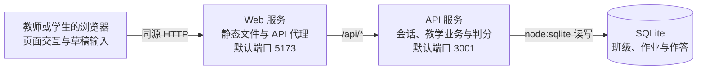
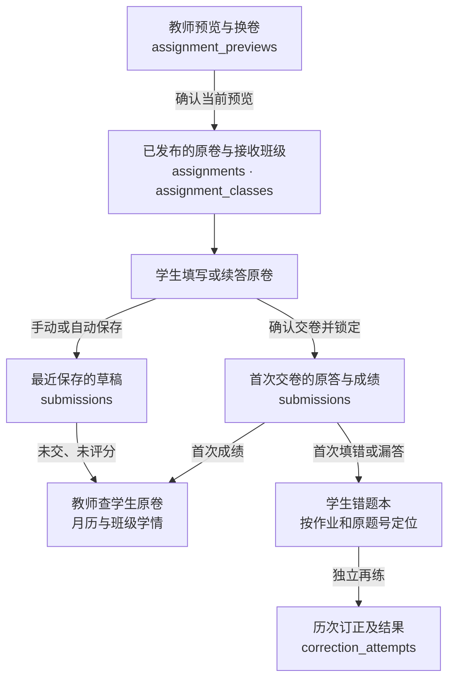

# 班级作业系统架构

本文对应 INC-010 内网应用 `46cf58f`。浏览器从同一个站点加载页面、请求作业数据。Web 服务负责交付页面和转发请求，API 服务负责权限、出题、判分和读写 SQLite。[应用启动说明](../../../classwork-repo/README.md) · [本版部署记录](../../开发记录/INC-010.md#内网部署)

## 运行架构

`npm start` 启动两个独立的 Node.js 进程。Web 服务返回 HTML、JavaScript、CSS 和名单样例，将 `/api/` 请求及 Cookie 转发给本机 API，再将响应送回浏览器。API 根据会话识别师生身份，按角色、当前班级和历史作业归属检查访问范围。本地默认数据库为 `data/classwork.sqlite`，可通过 `DB_PATH` 指定。[启动脚本](../../../classwork-repo/scripts/start.mjs) · [Web 服务](../../../classwork-repo/frontend/server.mjs) · [API 启动入口](../../../classwork-repo/backend/server.mjs) · [路由与权限判断](../../../classwork-repo/backend/app.mjs)

图中端口取自本地启动配置，两个服务默认监听 `127.0.0.1`。内网使用既有 Docker 容器，程序目录挂载到 `/app`，持久数据目录挂载到 `/data`。发布脚本先用同一镜像安装生产依赖、试读名单样例并打开临时库，再停服备份数据、切换程序，最后检查首页与健康接口。[部署脚本](../../../deploy.ps1) · [内网部署与备份核验](../../开发记录/INC-010.md#内网部署)

## 一份作业的数据流

- **发布。** 每位教师保留一份当前预览。确认时在同一事务内按已存题序写入作业、关联接收班级、记下发布结果。回执丢失后重试同一预览会得到同一作业编号。图中画的是教师页面流程，旧客户端也可通过 `POST /api/assignments` 直接发布。[预览与发布](../../../classwork-repo/backend/previews.mjs) · [写入作业与班级](../../../classwork-repo/backend/store.mjs)
- **作答。** 每名学生在每份作业上共用一条草稿与交卷记录。页面保存时携带 `draft_revision` 对应的版本号，遇到冲突可选择保留哪一份。限时卷首次开始的时刻另存于 `assignment_starts`，服务端取个人到期与全班截止的较早者。到点后仍可存草稿。正式交卷按全卷题数判分，原答与成绩随即锁定。[作答接口](../../../classwork-repo/backend/app.mjs) · [草稿与交卷回归](../../../classwork-repo/tests/drafts.test.mjs)
- **查成绩与订正。** 新卷按接收班级的当前学生名单统计。迁入的旧卷还通过 `legacy_assignment_students` 保留原班学生与作业的关系。月历按北京时间的发布日期归档，跨卷均分的分母是已交份数。学生每次订正单独写入 `correction_attempts`，教师始终能查到第一次交卷的答案和分数。[成绩名单](../../../classwork-repo/backend/reporting.mjs) · [学情汇总](../../../classwork-repo/backend/analytics.mjs) · [错题与订正](../../../classwork-repo/backend/corrections.mjs)

## 按功能找代码

| 要追踪的操作 | 代码入口 |
| --- | --- |
| 教师、学生如何切换页面，何时发出保存、发布或查询请求 | [浏览器页面与交互](../../../classwork-repo/frontend/app.mjs) |
| 班级、账号与会话如何保存，Excel 或 CSV 名单如何入库 | [路由与账号操作](../../../classwork-repo/backend/app.mjs) · [名单解析与导入](../../../classwork-repo/backend/roster.mjs) · [建表与旧库迁移](../../../classwork-repo/backend/store.mjs) |
| 专项、混合及组合卷如何生成，刷新后如何找回预览 | [整卷配置与组卷](../../../classwork-repo/backend/papers.mjs) · [混合题规则](../../../classwork-repo/backend/questions.mjs) · [预览存取与旧表兼容](../../../classwork-repo/backend/preview-store.mjs) |
| 教师从某天的练习、某名学生的记录或一道常错题查回原卷 | [月历日期](../../../classwork-repo/backend/calendar.mjs) · [学习历史筛选](../../../classwork-repo/backend/records.mjs) · [班级报告名单](../../../classwork-repo/backend/reporting.mjs) · [逐题汇总](../../../classwork-repo/backend/analytics.mjs) |
