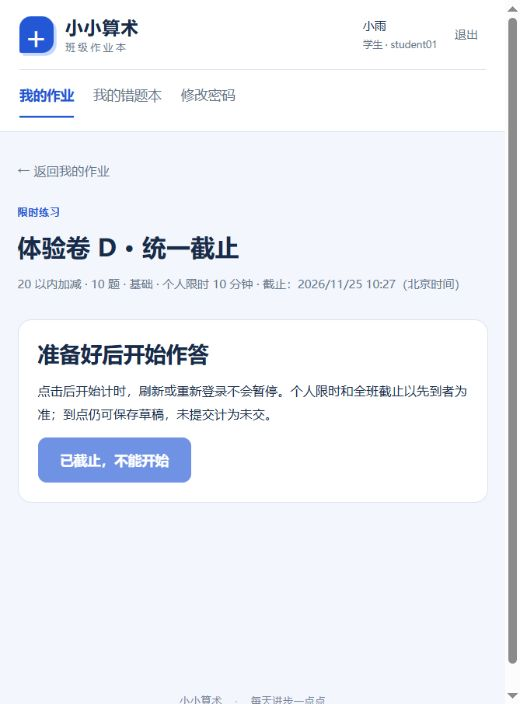

# 小小算术体验报告 · 问题清单

2026-11-25 实测，应用版本 `46cf58f`（INC-010），审查仓库起点 `6803774`。以下 6 项均通过浏览器正常操作复现。建议先处理会影响答案保留的 Q01、Q02，再统一截止状态。产品扩展和验收场景见[需求建议](体验官需求建议-2026-11-25.md)。

| 编号 | 谁会遇到 | 可观察到的问题 | 优先级 |
| --- | --- | --- | --- |
| Q01 | 学生做长卷 | 一题越界，其他题的有效答案也停止自动保存 | 高 |
| Q02 | 已打开答卷的学生 | 登录状态失效后，同账号重登丢失最后一次输入 | 高 |
| Q03 | 在首页等候的学生 | 截止已过，原页面继续显示“开始作答” | 中 |
| Q04 | 到截止时还没开限时卷的学生 | 首页给出“查看草稿”，进入后没有可查看的内容 | 中 |
| Q05 | 核对未交名单的教师 | 个人限时已过，教师成绩表只标“草稿” | 中 |
| Q06 | 设置综合卷的教师 | 去掉混合运算，难度说明仍说有三步混合题 | 低 |

高表示已经重现输入丢失，或有效输入无法存档。中表示师生会据页面状态判断能否开始、交卷或催交。低表示出卷说明有误，实际题面正确。

## Q01　一题越界会阻止整卷自动保存

1. 打开一份全新的 50 题综合卷。在第 50 题填 `999`，到第 1 题填合法整数 `7`，停笔等保存状态变化。
2. 页面显示“已作答 2 / 50 题”和“答案格式有误，请修正后保存”。提示里没有题号。保持原页打开，用同一学生在第二页打开同一卷，读到 **0 / 50**，第 1、50 题都空着。
3. 回原页清空第 50 题，等“已保存”，刷新第二页。这次读到 **1 / 50**，第 1 题为 `7`。说明此前有效答案也没有写入草稿。

**影响与复验**　输入仍在原页，学生若以为只是最后一题有误，换设备时会发现前面的作答也没有跟过来。建议允许先保存其他合法答案，明确指出“第 50 题尚未保存”并提供定位。用同一组输入复验时，第二页应能恢复 `7`。正式提交时仍须处理越界项。当前可先修正或清空越界题，等“已保存”后再离开。

## Q02　登录失效后重登，最后一次输入消失

1. 学生在 50 题卷第 1 题填 `7`，等“已保存”。同一浏览器的另一标签页正常退出该学生账号，以此构造可重复的会话失效条件。
2. 回仍显示答卷的原页，在第 2 题填 `8`，停笔。自动保存后，原页直接变成“登录作业本”。
3. 用原学生账号重新登录并打开同一卷。实测仍是 **1 / 50**，第 1 题为 `7`，第 2 题为空，没有恢复提示。

**影响与复验**　学生可找回上次成功保存的内容，两次保存之间的输入需要重填。这是原 19 项清单第 ⑨ 项已知缺口，本次取得了实际界面证据。建议重登后明确提示恢复哪份作业、哪几题。同一例应恢复 `7` 和待保存的 `8`。换学生进入同一浏览器时须隔离恢复内容。详见[原清单与实际交付](../plans/19项功能的优先级与轮次.md#原清单与实际交付)。

## Q03　首页停留到截止之后，卡片继续邀请学生开始作答

1. 给作业 D 同时设个人限时 10 分钟和一个即将到来的全班截止。本次为北京时间 10:27。在截止前打开学生首页，保持一页停留，始终不开这份卷。
2. 10:27 之后，原页的 D 卡片仍显示“待完成”“开始作答”。同账号重新进入的首页已显示“已截止 · 未交”。
3. 从新首页打开 D，卷内按钮为禁用的“已截止，不能开始”。两次观察的是同一个学生和同一份作业。

**影响与复验**　等待中的学生会按过期入口操作，进入卷面才知道来不及。首页跨过截止时应同步更新卡片、可交份数和可用操作。从后台切回时也应重新判断。复验既要看长时间停留的旧页，也要看新打开的首页。手动刷新可更新卡片。

## Q04　从未开卷，截止后的“查看草稿”点进去无稿可看

1. 沿用 D 卷，在该学生从未点过“开始作答”的前提下，等全班截止后**刷新**首页。
2. 首页说明已截止未交的作业“仍可查看和保存草稿”，D 卡片显示“查看草稿”。点进去只看到“准备好后开始作答”和禁用的“已截止，不能开始”。页面没有题面、历史答案或草稿入口。
3. 对照 B 卷，学生曾开卷并存过 1 题。个人限时归零后重新进入，能够看到原答案，也能填第 2 题并保存。两种情况在首页用了同一个操作名称。

**影响与复验**　建议将“未开始且已截止”写明为“未开始，无草稿”，进入后说明原因。已经开卷且有草稿的学生继续看到“查看草稿”。该修正只涉及状态和导航，可沿用限时卷原有的开题规则。

## Q05　个人限时归零，教师成绩表只显示“草稿”

1. 给 B 卷设置个人限时 1 分钟，全班截止时间留空。小雨开始并保存 1 题，小明始终不开始。
2. 小雨到时后看到“剩余 0 分 00 秒”和禁用的交卷按钮，首页已标“已截止 · 未交”。此时仍可保存草稿。
3. 截止后教师重新进入 B 卷的成绩明细。卷头显示“个人限时 1 分钟”“不限截止时间”。小雨的行只标“草稿”，小明的行是“待完成”。教师能区分两人是否有草稿，却看不出小雨已经无法交卷。

**影响与复验**　教师可能提醒一个已无法提交的学生去交卷。建议同时展示可提交状态和草稿状态，例如小雨“个人已到时 · 有草稿”，小明“尚未开始”。用同班两人不同开始时间再验一次，在同一时刻应分别得到各自状态。草稿继续计未交，均分只纳入正式交卷。

## Q06　不含混合题的综合卷仍提示“三步混合题”

1. 教师在发布面板选“综合练习”，仅勾选“20 以内加减”和“20 以内乘除”，去掉“100 以内混合运算”，选“提高”、10 题。
2. 难度旁仍写“混合题实际运算 3 步”。生成预览，实际是加减 5 题、乘除 5 题，预览分别给出了进退位和乘除法规则。

**影响与复验**　教师需要生成整卷才能判断设置区的哪条说明适用。难度提示应跟随勾选内容变更，只解释选中的题型。把混合运算重新勾上时，再显示相应步数。当前可依据整卷预览核对题型。

## 复测环境和通过的对照

本机 Windows、Codex 内置浏览器、Node.js 22.17.0。使用独立 SQLite、临时端口和虚构学生，未使用内网班级数据。在独立库执行 `npm run demo` 后，原班有两名学生和一份旧练习。另建体验二班，依次从教师界面发布 A（10 题加减）、B（10 题，个人限时 1 分钟）、C（50 题综合，发两班）、D（10 题，双时限）。复测 D 时把截止设在当前时间之后约两分钟即可。随机题面会变化，Q01 至 Q06 均可用新卷验证。

| 正常流程 | 本次实测 |
| --- | --- |
| 名单导入与姓名核对 | 四行 CSV 中两行学号 `00123` 重复，一行姓名为空，一行有效。页面反馈导入 1 名、跳过 3 行，逐行标因，有效学号 `00124` 保留前导零。 |
| 预览、续答和双页冲突 | C 卷预览三类题分别为 17、17、16。A 卷两题存好后刷新，`17` 和 `0` 都保留。同一学生在两页给同一道题填 `6` 和 `8`，旧页自动保存暂停，保留 `8` 并出现两种冲突处理选项。 |
| 批改、订正和统计 | 小雨 1 对、1 错、8 漏，交卷得 10 分，错题本收录 9 题。把第 2 题订正为 `13` 后，班级学情里该题的首次原答仍是 `0`。月历显示 A 卷 1/2 已交、均分 10。小明随后确认全空交卷，成绩表变为两人已交、分别 10 与 0 分、均分 5。 |
| 自动化回归 | 本次重新运行应用的 `npm test`，87 项通过，0 项失败。上面的边界问题另经浏览器操作核实。 |

本次记录反映体验官在隔离实例中的操作。学校网络、真实手机键盘和学生独立试用仍待现场验证。
