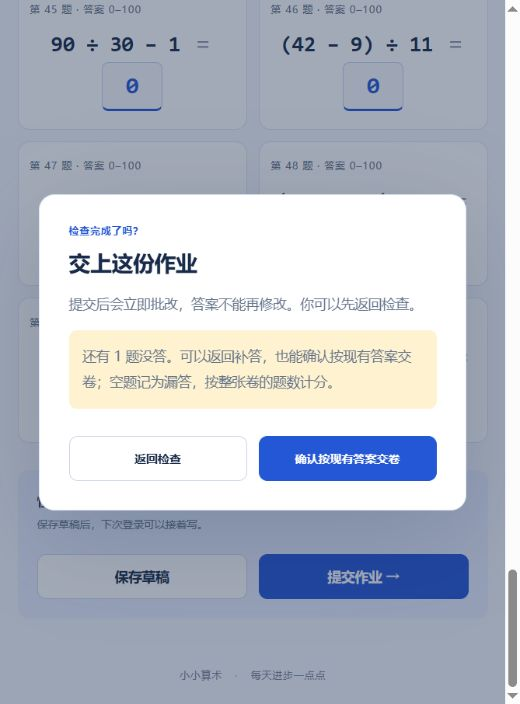

# 小小算术体验报告 · 需求建议

建议先让学生**找回刚写的答案，也能直接跳到漏答题**。本次 50 题卷只漏了第 2 题，交卷弹窗准确数出了 1 题。点“返回检查”后，页面却仍停在卷尾。教师侧最值得先讨论的是转班后的成绩归属。一名学生转班后，同一份旧作业的班均从 10 分变成了“暂无提交”。

体验日期为 2026-11-25，应用版本为 `46cf58f`。以下是待选需求，优先级是体验官判断。实测环境、6 项问题及复现步骤见[问题清单](体验官问题清单-2026-11-25.md)。

## 同类产品怎么处理相同的任务

| 教学任务 | 同类产品的做法与证据 | 本项目可以借鉴的部分 |
| --- | --- | --- |
| 学生做一次短练习 | **ThatQuiz，公开页面实操。** 我在算术练习里给 `7 + 8` 填 `15`，按 Enter 后正确数从 0 变为 1，下一道 `3 + 3` 的输入框已获得焦点。[公开算术练习](https://www.thatquiz.org/tq/practice.html) | 已交作业和独立练习有不同用途。错题订正后可以顺手做一道新题，正式作业继续支持整卷检查。见 R06。 |
| 学生判断先做哪一份 | **Microsoft Teams 教育版，官方学生帮助。** 成绩页同时呈现作业状态、得分和截止日期，可按截止时间或作业排序。[学生成绩页说明](https://support.microsoft.com/en-gb/education/insights/track-your-progress-in-the-grades-tab-student) | 学生首页已经有作业卡片，可优先展示快到期的待办，把已批改记录收在另一个入口。见 R03。 |
| 教师给部分学生补练、交付成绩 | **Google 课堂，官方教师帮助。** 教师可以将测验分配给个别学生。单份作业或整门课的成绩可下载为 CSV。[分配测验](https://support.google.com/edu/classroom/answer/9095575?hl=zh-Hans) · [下载成绩](https://support.google.com/edu/classroom/answer/6020294?hl=zh-Hans) | 保留已有平行班同卷发布。在讲评后补充按学生选人，成绩导出先做到一班一卷。见 R05、R07。 |
| 教师从错因转到下一次练习 | **17zuoye 考试阅卷帮助中心、IXL 官方案例。** 前者介绍了按错题的知识点和难度重配类题，后者介绍了针对同一易错技能和难度发起小组练习。[错题出题说明](https://zx-math.17zuoye.com/exam-help/常见问题/考试阅卷/如何进行错题出题) · [IXL 小组练习说明](https://blog.ixl.com/2022/08/29/whats-new-on-ixl-august-2022/) | 本项目已经能定位原答，也有出题器。先复用 20 以内加减这一类，验证是否能把讲评接到一次针对性练习。见 R05、R06。 |

ThatQuiz 的记录来自当场完成的一道公开练习。其他产品依据表中的官方说明，17zuoye 的页面描述的是考试阅卷场景。以下验收数字是为本项目设计的样例。

## 七项候选需求

### R01　离开或登录失效后接着写 · 优先

已有停笔自动保存，正常刷新能恢复答案。当另一页退出账号时，原页刚填的 `8` 会随登录跳转消失。50 题卷中只要有一题越界，其他题的有效答案也无法自动保存。旧清单的第 ⑦、⑨ 项可用这两个具体场景验收。[Q01、Q02 的实测](体验官问题清单-2026-11-25.md) · [原需求对照](../plans/19项功能的优先级与轮次.md#原清单与实际交付)

**验收示例**　有未存输入时给出“保存并离开”，明确显示还有哪几题未存。第 1 题存过 `7`、第 2 题刚填 `8` 时使会话失效，原账号重登可回到该卷，恢复两题并看到保存结果。换一个学生登录看不到前一人的待恢复内容。有两个不同版本时，沿用现有的草稿冲突选择。

### R02　从交卷提示直接跳到漏答题 · 优先

C 卷 50 题只留第 2 题空白，第 49 题为 `6`。在卷尾点提交，提示准确报出“还有 1 题没答”，却没有给出题号。点“返回检查”后焦点仍在“提交作业”。在本次实测的 520 × 726 CSS 像素视口，第 2 题输入框位于可视区上沿之上约 2,942 像素。

**验收示例**　弹窗写明空题号，增加“去补第 2 题”。选择后滚动到该题并聚焦输入框，其他 49 题保持原值。留空第 2、27、50 题时，可依次跳转。填 `0` 算已答。补完后可以回到交卷检查，也继续允许学生确认按现有答案交卷。

### R03　先看我还能交什么、哪份最急 · 较高

一名学生同时收到 A 至 D 和演示练习，首页把已批改、快到期、已到期和不限时的卡片排在一起。个人限时 B 已经归零时，卡片仍有“不限截止时间”这句全班规则。学生需要读几处信息才能判断眼下能做什么。

**验收示例**　提供“待完成”“已截止未交”“已批改”入口。待完成优先显示离实际可交截止最近的作业，明确写出是全班截止还是本人的交卷时间。用一份还剩 2 分钟的个人限时卷、一份明天截止和一份不限时卷一起验收，只有 2 分钟的卷排首位，到时从可交列表移出。未开始个人计时的卷标明“开始后计时”。已交 0 分归入已批改。入口和教师行状态先修正[问题 Q03 至 Q05](体验官问题清单-2026-11-25.md)。

### R04　保留学生转班前的历史成绩 · 较高，先确认统计口径

A 只发给原班。小雨得 10 分，小明未交，原班均分为 10。小雨调入体验二班后，原班 A 成绩表只剩小明、均分变成“暂无提交”。从二班查小雨的练习能看到两班都收到的 C，查不到 A。把小雨调回，A 的 10 分重新出现。现行说明已写明新卷按当前名单统计，分数仍保存。需要教研组决定的是日后查成绩采用哪一份名单。[现有统计口径](已实现需求.md)

**验收示例**　让教师同时查到“发布时班级”和“当前班级”，给已发布作业保留历史名册与转班标记。按上述步骤转班后，回查 A 应见原班 1/2 已交、均分 10。小雨个人历史带“原班级”标记，仍可点回已交原卷。转班后的新作业按新班接收。对于转班前已布置但尚未开始的任务，应先由教师确认是否随人保留。

### R05　从一道常错题给选中的学生布置补练 · 后续教学试点

在 A 卷第 2 题，学情页能分清小雨填错、小明当时未交，也能展开小雨的原答。要针对这次错误再布置练习，发布页的接收对象只能勾班级，教师还要重选题型和难度。

**验收示例**　常错题明细提供“按这类题补练”，带入知识点、难度和建议名单，由教师确认后预览发布。以 1 人答错、1 人漏答、1 人未交为例，分组显示三人，让教师选择前两人发 10 题。只有选中者收到作业，补练结果可单查，原作业的分数和人数照常回查。

### R06　原题订正正确后，换一道同类题独立练 · 后续教学试点

小雨把 `18 − 5` 从 `0` 改成 `13`，看到了正确反馈、讲解和订正次数。现有“合上讲解，再练一次”重做同一道题。要判断孩子能否独立算对另一道不退位减法，还缺一次新的尝试。

**验收示例**　在订正成功后提供可选的“换一道同类题”，先支持基础加减。给 `18 − 5` 匹配一道不同的 20 以内不退位减法，作答前隐藏答案，按 Enter 或按钮提交后显示反馈。类题成绩单独记作练习。重开原卷仍是 10 分，原题仍显示首次订正正确发生在第 1 次。此项可独立于 R05 先试用。

### R07　按当前班级导出一份作业的成绩 · 按教师需求安排

A 卷最终成绩表能清楚区分小雨 10 分、小明 0 分，班均为 5。导入名单时学号可以保留前导零。教师若要把成绩带去教研会，当前成绩页只有查看和刷新入口。

**验收示例**　在一班一卷的成绩页提供导出，包含作业、班级、姓名、文本学号、提交状态、提交时间和首次得分。样例中应保留已交的 `0`，未交学生的分数留空，学号 `00124` 用常用表格软件打开仍完整显示。平行班切到二班后，导出只含二班名单，人数、分数与当页一致。

## 建议的试用顺序

先拿 R01、R02 给学生做一次“写到一半离开，再找回唯一漏题”的试用，两步都可以用是否找回、能否一步到题来判断。教师端先复核三种截止状态，再请班主任用 R04 的两人样例选定历史统计口径。R05、R06 可请数学老师用同一个错题验证补练价值。R07 取决于学校是否确有成绩导出需求。各项尚待师生确认和排期。
